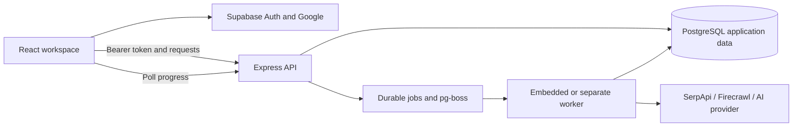

# Tudla architecture

This guide describes the TypeScript application in `apps/` and `packages/`. The default deployment is the browser-local demo; authenticated workspaces require a separate self-hosted API, database, and worker.

## Request and job flow

A signed-in browser obtains a Supabase session. The API verifies its JWT using the configured project's public signing keys, checks workspace membership, and executes database work with transaction-local identity. The browser accesses application records through Express; Supabase supplies authentication and can also host the PostgreSQL database.

Slow discovery, enrichment, campaign drafting, and analysis become persisted jobs. The worker rechecks the actor's access and provider connection, reserves usage, executes bounded external work, and saves results and progress. The UI polls for job state.

The browser demo is a separate path in `apps/web/src/data.ts`. It uses fictional localStorage records and deterministic sample drafts/analysis; its behavior is not evidence of a live AI request.

## Code ownership by folder

| Area                   | Main files                                                               | Responsibility                                                                                   |
| ---------------------- | ------------------------------------------------------------------------ | ------------------------------------------------------------------------------------------------ |
| Workspace and landing  | `apps/web/src/App.tsx`, `Landing.tsx`                                    | Navigation, queries, record actions, confirmations, and entry modes                              |
| Record workflow        | `ProspectTable.tsx`, `Detail.tsx`, `BusinessForm.tsx`, `NotesEditor.tsx` | Table comparison, research, corrections, notes, and follow-up dates                              |
| Campaigns and outreach | `CampaignComposer.tsx`, `OutreachComposer.tsx`, `email.ts`               | Reviewed campaign fields, persisted drafts, and email-app handoff                                |
| Browser state          | `apps/web/src/data.ts`, `followups.ts`                                   | API requests, fictional demo persistence, CSV helpers, and local-date behavior                   |
| API boundary           | `apps/server/src/app.ts`, `auth.ts`, `config.ts`                         | Endpoints, verified identities, runtime validation, and public configuration                     |
| Data access            | `repository.ts`, `ai-store.ts`, `ai-routes.ts`                           | Workspace transactions, imports, records, draft settings, and job admission                      |
| External AI            | `ai.ts`, `ai-tasks.ts`                                                   | Provider adapters, task prompts, structured/JSON-text output, validation, and safe error mapping |
| Sources and encryption | `providers.ts`, `security.ts`                                            | Discovery, optional retrieval, URL screening, and encrypted credential envelopes                 |
| Worker                 | `queue.ts`, `worker.ts`, `index.ts`                                      | Queue dispatch, checkpoints, provider locks, recovery, and lifecycle                             |
| Shared domain          | `packages/contracts/src/index.ts`                                        | Zod request/output schemas, criterion checks, identity keys, safe URLs, and CSV cells            |
| Storage                | `packages/database/src/`, `packages/database/drizzle/`                   | PostgreSQL tables, migrations, row-level security, and role-scoped functions                     |

Frontend filenames in the table are relative to `apps/web/src/`; server filenames are relative to `apps/server/src/`.

## Record model

A **business** is a workspace-owned source record. A **campaign entry** connects that business to a campaign and stores its stage, notes, assigned member, follow-up date, email draft, and feedback. The same business can appear in several campaigns without sharing those entry-specific fields.

**Observations** retain source facts and timestamps. **Analyses** retain generated output, input facts, model/prompt metadata, and the campaign context used for research. Changes to the offer, targets, or criteria can therefore make older research outdated. Manual business corrections preserve provenance and invalidate obsolete source fields.

Other persisted records include users, workspaces, memberships, invitations, connections, AI settings, campaign drafts, jobs, usage events, source-search caches, and saved views. Migrations add composite workspace constraints so references cannot cross workspaces.

Deleting an entry cascades its analysis and removes its entry-specific notes/draft. Deleting a campaign also cascades its entries and jobs while clearing accepted-draft references. Shared businesses remain. The delete routes acquire the batch worker's advisory lock and return a conflict while batch processing holds it.

## Authentication and credentials

- Supabase Google-linked JWTs are checked for signature, issuer, audience, identity, role, and expiry. The API accepts ES256/RS256 rather than a shared-secret bypass.
- API membership/role checks and PostgreSQL row-level security enforce workspace access. Database identity is set within the transaction, avoiding identity reuse across pooled requests.
- Migration/admin, application, and queue roles are distinct. Runtime startup rejects an application role with superuser privileges, RLS bypass, or application-table ownership.
- Provider keys use AES-256-GCM with authenticated context bound to workspace/provider. API responses expose masked metadata; credentials stay out of browser data and queue payloads.
- Key envelopes support a versioned keyring and staged re-encryption. Invitations use hashed, expiring, one-use tokens. Member removal revokes access and cancels pending work.

These are implemented boundaries with automated coverage, not a security certification. See [Security](SECURITY.md) for reporting and deployment responsibilities.

## AI and source separation

SerpApi supplies Maps business listings; CSV/manual entry work without an AI key. Firecrawl optionally retrieves text for selected businesses after public-target screening. The hosted retrieval service owns its downstream navigation behavior.

Groq, Google AI, and a host-configured OpenAI-compatible service share one adapter. Workspaces select a provider, model, and native structured or JSON-text response mode. Both paths apply runtime schemas. Research validation requires the expected criteria, known evidence IDs, and evidence for non-unknown assessments. That validates structure and references; it does not prove every generated sentence is true.

Campaign drafting can return clarification questions and labeled assumptions. It persists the original brief, revisions, and result. Accepting edited fields is a separate operation that creates the campaign. Request IDs prevent duplicate submissions; identical recent results can be reused within one workspace for 15 minutes. Queued drafts keep the submission-time provider/model selection.

Outreach templates use local deterministic composition from campaign context. Saving a draft consumes no AI request. The app opens a `mailto:` link only after an explicit action; sending happens in the user's email application.

## Job coordination and usage

Application jobs and pg-boss state live in PostgreSQL. Separate draft/batch queues share a worker concurrency bound that leaves a database connection available for writes. Session advisory locks coordinate batch/draft work across workers; provider locks serialize calls for a workspace/provider. These locks must be acquired in the same database.

The worker checks saved checkpoints before repeating completed work, records usage reservations atomically, pauses on quota problems, and supports cancellation/resume. The AI adapter disables automatic provider retries. Ambiguous timeouts remain explicit because a provider may have charged for a request whose result was lost; this is not an exactly-once billing guarantee.

A one-hour workspace source cache preserves the original observation time and rechecks connection access. Usage records track attempts, cache hits, supplied token counts, and known credit estimates. Unreported usage stays unknown; provider billing is authoritative.

## Runtime and operations

A multi-stage Docker image runs as the `node` user. Its default target contains only the browser build and a static server. The default Compose configuration binds the demo to loopback and starts no database. The optional `live` target and `compose.live.yaml` provide an API, PostgreSQL, migrations, and a worker for explicit self-hosting. Always-on processing needs a service that stays running.

`/api/health` checks configured database availability and reports demo/live mode. It does not verify Google login, an external provider, or worker progress. `tools/` provides role setup, history maintenance, key rotation, and evaluation entrypoints. Setup and operational details belong in [Deployment](docs/DEPLOYMENT.md).

## Verification and capacity limits

GitHub Actions installs from the lockfile, builds, configures a disposable PostgreSQL service, runs unit/integration checks, validates evaluation fixtures, and builds the image. It does not deploy or contact live Supabase/provider accounts.

The desk currently reads at most 2,000 entries per workspace; CSV import accepts at most 200 businesses per request. Queue concurrency tests cover coordination with stubbed providers. They do not establish production throughput or AI accuracy. Deferred work is in [IMPROVEMENTS.md](IMPROVEMENTS.md).
